# ASTRODYNAMICS LAB

中文 | [English](readme_english.md)

一个可以直接运行的 **Python + OpenSceneGraph + Qt 桌面 demo**。

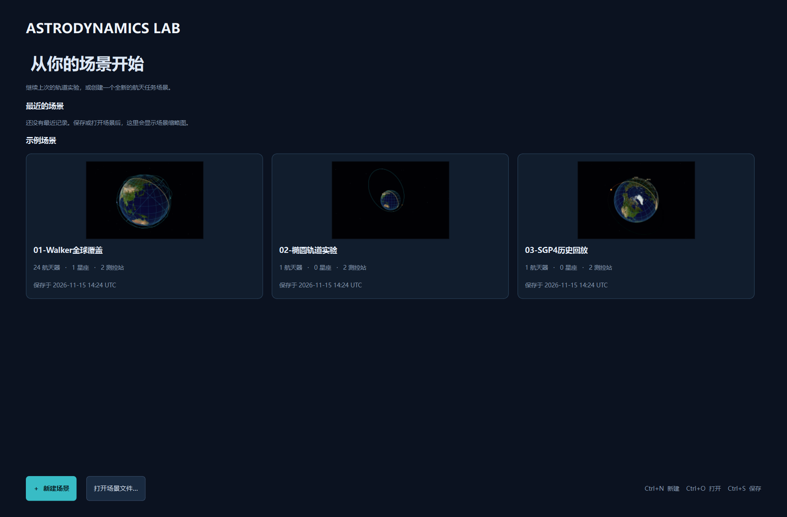

## 当前机器启动

双击 `run_demo.bat`，或在此目录执行：

```powershell
.\.venv\Scripts\python.exe main.py
```

本项目已经安装独立 Python 3.12 环境及依赖，没有修改系统 Python。
启动后先进入欢迎页。点击场景卡片继续，或使用下方“＋ 新建场景”进入空白场景；首次进入轨道视图可能需要几秒钟初始化显卡。

## 场景保存、加载与欢迎页

欢迎页显示最近保存 / 打开的场景卡片，包含真实缩略图、场景名称、航天器 / 星座 / 测控站数量及保存时间。
最多保留 24 条最近记录，支持滚动查看；文件移动或删除后会标记为不可用，可通过“打开场景文件…”重新定位。
第一次启动没有最近记录时，提供三个真实可加载的示例：Walker 全球覆盖、椭圆轨道实验、SGP4 历史回放。
示例位于 `examples/`，SGP4 示例采用 2000 年历史验证 TLE，不代表当前实际轨道。

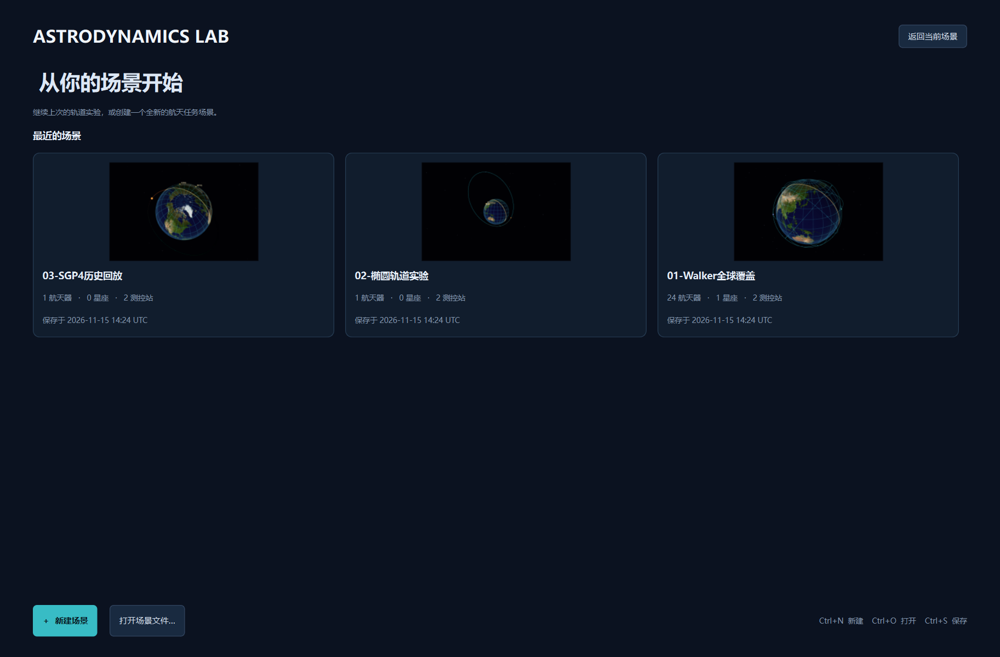

1. **新建**：欢迎页下方“＋ 新建场景”或 `Ctrl+N`，创建空场景，再添加单星、Walker 星座或测控站。
2. **保存**：工作区右上角“保存”或 `Ctrl+S`，首次保存选择路径；“另存为”或 `Ctrl+Shift+S` 可生成独立副本。
3. **加载**：“打开场景”或 `Ctrl+O` 选择 `.astro.json` 文件，也可直接点击欢迎页中的场景卡片。
4. **返回欢迎页**：工作区右上角“欢迎页”保留当前配置并暂停播放；“返回当前场景”继续编辑。

窗口标题中的 `*` 表示资源或显示配置有未保存的修改。新建、加载其他文件或关闭窗口时，可以选择保存、不保存或取消。
仅播放推进时间、移动相机不触发配置修改提示；手动保存仍会记录保存瞬间的时间与视角。

场景文件为带版本号的 UTF-8 JSON，包含：

- 每颗航天器的名称、标识、原始二体六根数 / TLE 及原始历元；Walker 的分组标识和完整生成参数。
- 测控站名称、经纬度、高度与显隐；星体、轨道、尾迹的逐资源显隐，以及颜色和线宽。
- 经纬网间隔、颜色、线宽、共享显示开关；选中航天器、共同 UTC 历元、仿真进度、倍率、当前页与相机视角。
- 用于卡片的 PNG 缩略图；不依赖原始 TLE 文件路径，复制 `.astro.json` 文件即可在另一份本软件中恢复。

加载后停在保存的仿真时刻，保持**暂停**，便于先检查配置再播放。空场景和仅包含测控站的场景也可以保存。
文件解析、有效性校验与引擎准备在后台完成，成功后才替换当前场景；无效或损坏的文件不会清空当前配置。
保存采用临时文件和原子替换，写入失败时保留原文件。单个场景文件上限为 32 MB，已测试 10,000 星往返恢复。
最近文件索引位于项目目录 `.astro_lab/recent.json`，只管理启动卡片；实际配置以用户选择的 `.astro.json` 文件为准。

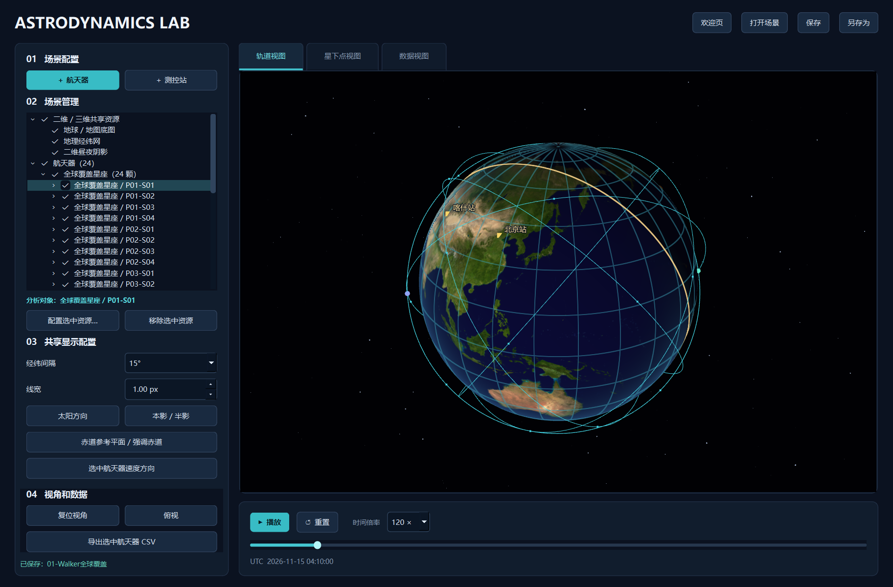

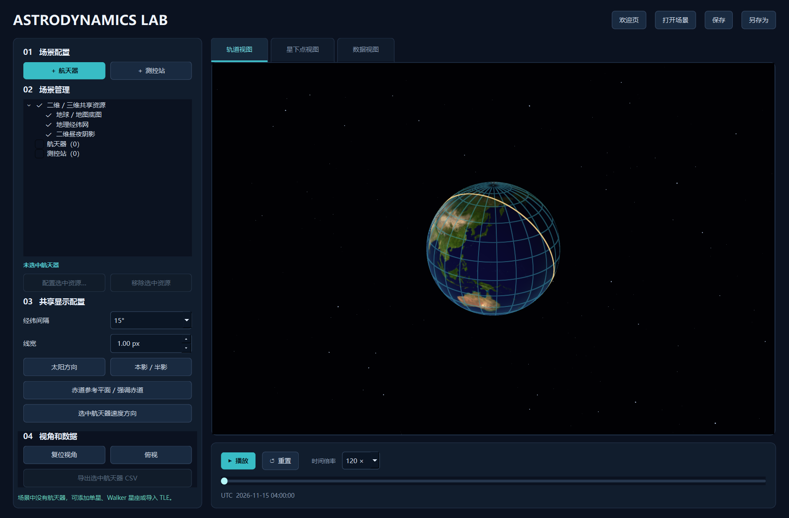

## 功能

- NASA Blue Marble 真实地球纹理、随 UTC 自转的地球、星空和太阳昼夜光照。
- 可切换二体 / SGP4 模型：六根数或 TLE 输入，明确显示 UTC 历元与坐标系。
- 本影/半影空间边界、太阳方向、卫星入影变暗及太阳可见面积比例。
- 中文 Qt 控制面板：四种二体预设、播放/暂停、重置、1–1000 倍速、进度拖动。
- 左键旋转、滚轮缩放、复位视角、俯视，以及网格和阴影边界开关；星空常显。
- 右侧分为“轨道视图 / 星下点视图 / 数据视图”三个 Tab，默认打开轨道页；原顶部四个数据卡片已移除。
- 导出当前仿真时刻起一周期的 721 个位置、速度与光照采样点到 CSV，包含模型、坐标系、历元和 UTC。
- 二体参数检查、TLE 格式/校验和检查、SGP4 传播错误处理；无效输入不会覆盖当前模型。
- 场景文件保存 / 加载、最近场景缩略图卡片、三个内置示例与空白新建入口。

## 关于 osgQt

本 demo 的技术路线是 **PySide6 / QOpenGLWidget + OpenSceneGraph.py / osgViewer**。
`orbit_demo/scene.py` 以 Python 实现 osgQt 式的 Qt/OSG 嵌入层：Qt 管理窗口和 OpenGL 上下文，OSG 管理场景图并绘制。
**本项目没有链接历史 C++ osgQt 库，也没有冒充 `import osgQt` 的 Python 包。**

选择这一实现是为了在当前 Windows 机器上交付可运行版本，无需额外编译 C++ Qt 绑定。
如果后续必须使用指定版本的 C++ osgQt，可以保留轨道计算和控制界面，替换 `OrbitView` 嵌入层。

嵌入实现处理了 Qt 非零默认 FBO、高 DPI 视口、单线程渲染和退出时的上下文清理。
OSG 的几何缓冲区及着色器重复使用，不在每一帧重新编译着色器。

参考：
- [OpenSceneGraph.py 官方仓库](https://github.com/AlphaPixel/OpenSceneGraph.py)
- [osgQt 官方仓库](https://github.com/openscenegraph/osgQt)
- [Qt QOpenGLWidget 文档](https://doc.qt.io/qt-6/qopenglwidget.html)

## 新机器安装

建议 Windows x64、Python 3.12、支持 OpenGL 3.3 的显卡及驱动。OSG Python 包需要匹配的二进制 wheel；不要直接使用本机原来的 Python 3.11 环境。

```powershell
py -3.12 -m venv .venv
.\.venv\Scripts\python.exe -m pip install -r requirements.txt
.\.venv\Scripts\python.exe main.py
```

依赖版本：OpenSceneGraph 0.1.2、PySide6 6.10.1、NumPy 2.x、sgp4 2.25。
纹理已经随项目保存到 `assets/earth_day.png`，安装完成后可离线运行。

## 资源管理与模型配置

左侧按 **01 场景配置 / 02 场景管理 / 03 共享显示配置 / 04 视角和数据** 分区。
01 提供“＋ 航天器”和“＋ 测控站”；02 使用树视图管理二维和三维资源。勾选地球 / 地图底图、地理经纬网、
航天器星体 / 星下点、轨道 / 地面轨迹和尾迹，可同步控制两页显隐。
航天器父节点可以批量切换其三个图层，航天器总节点可以批量控制全体卫星；部分勾选显示中间状态。
树节点左键选中、勾选控制显隐；右键航天器、其图层或航天器分组，选择“轨道颜色与线宽…”打开独立小窗，
可预览并保存轨道 / 尾迹样式，或取消修改。单独添加的单星与每次添加的 Walker 星座为同级节点，星座内可展开成员。
星座节点或任一成员的样式设置应用到整个星座，独立单星设置仅作用于该星；航天器总节点可统一设置所有资源。
样式同时作用于二维、三维，切换分析对象和追加资源后保留。经纬网节点也支持右键颜色和线宽设置。
测控站右键可配置和移除，不提供不适用的轨道样式选项。
点击航天器名称或其子图层即可切换分析对象，数据页、选中高亮和 CSV 跟随切换，保持当前 UTC、播放状态与相机。
显隐与分析对象选择互相独立；隐藏航天器仍可分析数据。

**03 共享显示配置** 保留经纬间隔（5° / 10° / 15° / 30° / 45° / 90°）及线宽，
提供可切换按钮：太阳方向、本影 / 半影、赤道参考平面 / 强调赤道、选中航天器速度方向。
上述四个按钮默认均不选中。赤道参考平面与赤道强调合并为一个控制；太阳方向与阴影边界可分别开关。星空始终显示，不再提供显隐开关。
二维和三维共用同一个设置对象及地理坐标约定。三维采用抗锯齿着色器、二维采用 QPainter，
经纬线宽按逻辑像素设置；三维在极点附近渐隐密集经线。关闭地球底图时一并隐藏其表面经纬网。
**04 视角和数据** 放置复位视角、俯视和导出选中航天器 CSV。

点击 **＋ 航天器** 打开独立窗口，默认追加，也可选择替换全部；
点击 **配置选中资源…** 编辑当前单星的六根数 / TLE、Walker 星座完整参数或测控站坐标。
Walker 编辑回填名称、类型、星数、轨道面数、相位因子、高度、倾角、首面 Ω、首星相位与 UTC；保存后只重建该星座并保留配色，取消不修改场景。
取消不会改动场景；应用前检查数量和共同历元附近的传播有效性，失败时保留原场景。
修改资源配置并应用后时钟归零，场景起算 UTC 取全部航天器原始历元中的最新值；场景文件加载则恢复保存的共同历元和进度。每颗卫星按其原始历元偏移传播，
不会把不同 TLE 的相同相对秒数误认为同一 UTC。原始历元保留在树节点提示和 CSV 中。
当前最多支持 **10,000 颗**航天器，允许删除初始或最后一颗航天器。空场景保留地球、星空、测控站与 UTC 光照，清空旧轨迹和图表，暂时禁用航天器 CSV 与周期滑条；可继续新增资源。TLE 文件上限为 8 MB。
资源与显示配置可保存到 `.astro.json`，下次启动从欢迎页恢复。

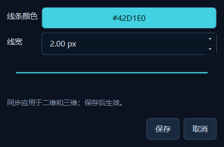

### 测控站

点击 **＋ 测控站**，输入名称、经度（东经为正，±180°）、纬度（北纬为正，±90°）和高度（0–20 km）。
测控站在二维地图显示为金色方形和名称，在三维球面显示金色标记与名称并随地球自转；名称跟随相机投影，地球背面的站名被遮挡，显隐随站点节点统一控制。
树中的测控站节点可单独或批量显隐，选中后可配置、移除。使用与地球一致的球面坐标；
三维标记略抬离表面以避免深度冲突。此版本不包含链路预算、覆盖圆或测控可见弧段计算。

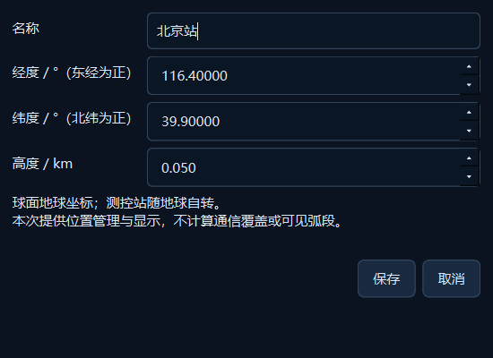

### 二体模型

编辑六根数和初始 UTC，或者选择近地、同步、高偏心等预设。默认历元固定为
2026-11-15 04:00:00 UTC，便于复现实验。

### SGP4 模型

粘贴完整的两行 TLE，可在第一行附加卫星名称。TLE 每行应为 69 个 ASCII 字符，
保留空格和末尾校验位；编辑框支持水平滚动查看完整行。
也可点击“读取 TLE 文件…”导入 UTF-8 / UTF-8 BOM 的 `.tle` 或 `.txt` 文件，支持多颗卫星，
可混合带名称的三行格式和不带名称的两行格式。整份文件校验通过后才载入，不跳过坏记录；
同一文件中的重复卫星编号会报错。单颗导入从 TLE 历元起算，多颗采用共同 UTC。

内置的 VANGUARD 1 是 **2000-06-27 的历史标准验证样例，不代表实时轨道**。
软件不自动联网更新 TLE；使用目标时间附近的 TLE 才有实际预测意义。
SGP4 使用 `sgp4.api.Satrec` / `SatrecArray` 和 WGS72 常数，自动选择近地或深空分支。
六根数面板不参与 SGP4 初始化，避免把二体瞬时根数误作 TLE 平均根数。

SGP4 输出是 **TEME**，不是 J2000 或 ECEF。场景显示当前时刻起一个平均周期的时间采样轨迹，
选中对象三维高精度轨迹每跨越 60 秒仿真时间刷新，其余轨迹按后台采样节奏刷新，
不强制闭合，也不会把传播时间按周期取模。
面板中的偏心率、倾角与周期来自 TLE 平均参数，近远地点是均值估算，非瞬时极值。
若选中传播器报告衰减或无效状态，播放暂停并显示错误；其他可见资源传播失败时隐藏其图层并提示。

### Walker 星座

“Walker 星座”页配置星座名称、Delta / Star、总星数 T、轨道面数 P、相位因子 F、高度、倾角、
首轨道面 Ω 和首星相位。采用圆轨道二体模型，要求 T 能被 P 整除，且 `0 ≤ F < P`。
令轨道面编号 p、面内星号 s 从零开始，则：

```text
每面星数 S = T / P
Ω(p) = Ω₀ + p × 360° / P  (Delta)，或 Ω₀ + p × 180° / P (Star)
ν(p,s) = ν₀ + s × 360° / S + p × F × 360° / T
```

历元使用配置窗口上方的 UTC；同一星座的所有轨道及尾迹使用统一颜色，选中星体仍用橙色标记。
每次创建都有独立星座标识，同名星座不会合并；支持整组显隐、样式设置、完整参数编辑与移除。
支持实际多星传播、三维渲染、二维轨迹及逐星数据分析。

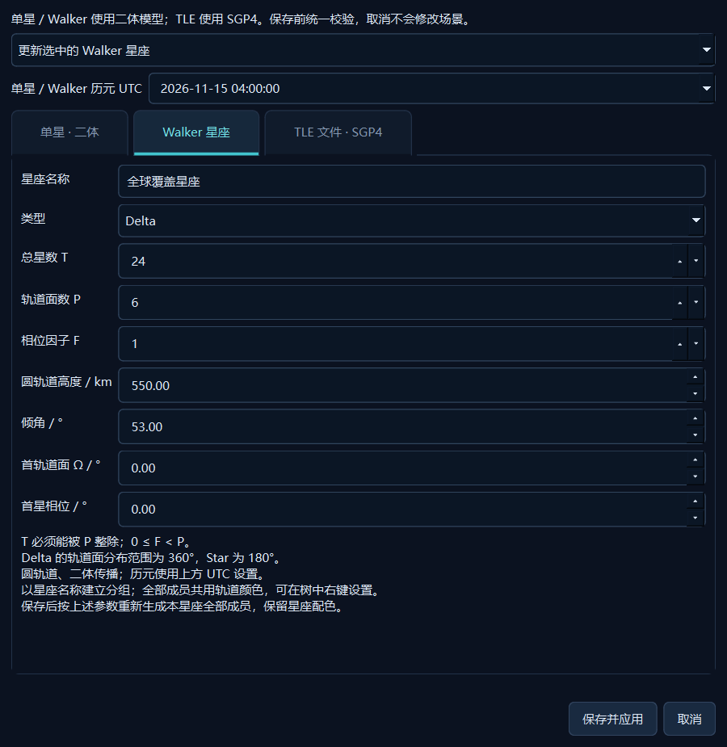
约定参考 [STK Walker](https://help.agi.com/stk/12.7.1/Content/stk/tools-12.htm)。

## 视图分区与图表接口

右侧三个 Tab 共用同一仿真时钟，
切换页面不会重置模型、播放进度或三维相机。

- **轨道视图**：OSG 地球、多星轨道、光照、阴影与卫星场景。经纬网默认 15°、赤道强调默认关闭；
  与真实纹理共用地固 UV 坐标并一起自转，样式与显隐由左侧统一控制。三维页底部原数据和操作说明已移除，以增加画面高度。
  页内重复的“轨道视图”标题与星下点页最上方说明文字已移除，以扩大视图。右上角状态小字、时间条右侧进度说明及整个窗口最底部技术文字已移除，时间条保留动态 UTC 文本；数据页布局保持不变。
- **星下点视图**：在本地 NASA 纹理地图上绘制当前星下点、未来一周期轨迹及过去 10% 周期轨迹；轨迹遵循资源 / 星座配色，未设置样式的独立选中单星使用青色轨道与橙色尾迹。
  地图采用等距经纬投影，跨越 ±180° 经线时分段绘制。球面星下点使用地心纬度；
  经度通过惯性位置减去当前 UTC 对应的 GMST 得到，与三维地球的近似转动约定一致。
  不包含极移、UT1 修正及大地纬度转换。当前点持续更新，轨迹在后台定期采样；
  隐藏时停止提交新轨迹任务，重新进入页面时刷新。
  根据同一 UTC 太阳方向叠加昼夜阴影，晨昏过渡区收窄，二维和三维均以浅金色线强调昼夜交界；夜侧最大遮罩不透明度约 58%，
  保留地表纹理可读性。轨迹、经纬网、卫星和站点在阴影上方绘制，可用“二维昼夜阴影”独立开关控制。
- **数据视图**：八张时间曲线：轨道高度、惯性速度大小 |v|、半长轴 a、偏心率 e、倾角 i、
  升交点赤经 Ω、近地点幅角 ω、真近点角 ν。页面可以纵向滚动，查看全部曲线。
  橙色游标与当前时间一致，图右上角显示该时刻的实际计算值，非采样插值。

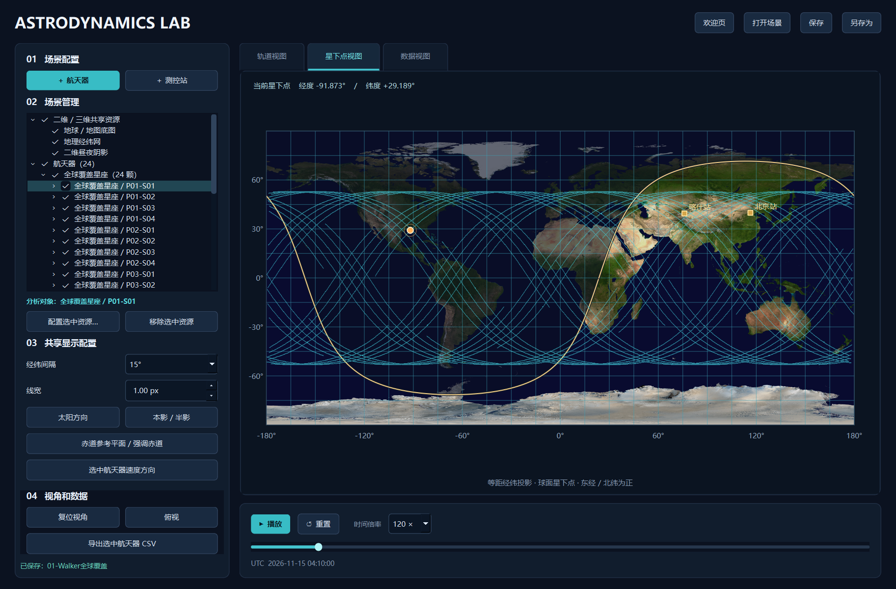

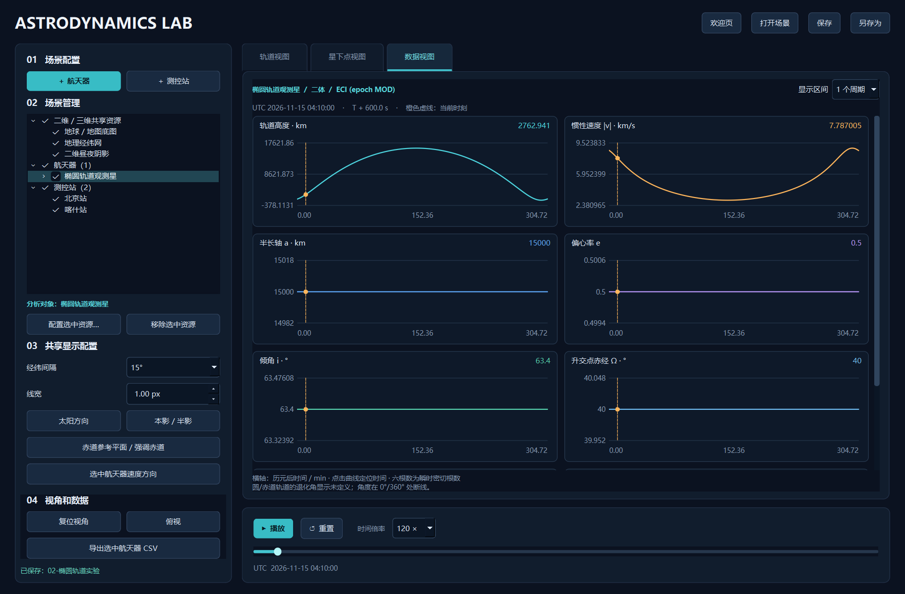

<details>
<summary>查看其他轨道示例截图</summary>

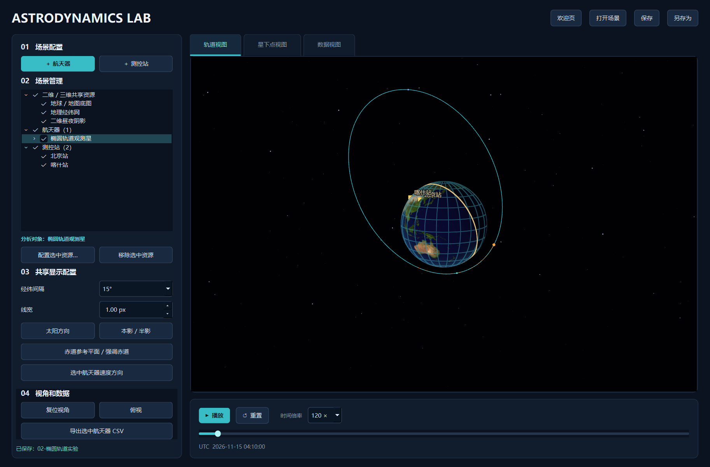

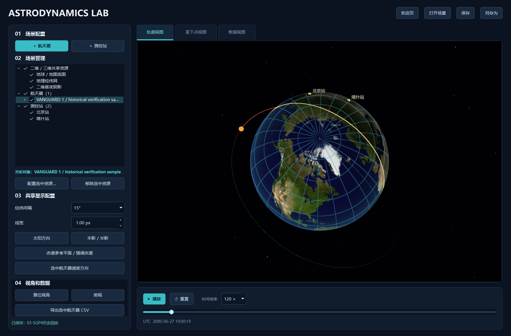

</details>

高度定义为 `|r| − 6378.137 km`；速度为模型原生惯性状态的 `sqrt(vx²+vy²+vz²)`，
没有扣除地球自转速度。二体采用其历元 ECI 坐标系；SGP4 采用 TEME（在页面标题明确标注），
没有把 TEME 分量冒称为 J2000 分量。

六根数从每个采样时刻的位置、速度反算，SGP4 使用其 WGS72 引力常数，显示的是**瞬时密切根数**，
不是把 TLE 平均六根数复制为常数曲线。二体无摄动模型中 a、e、i、Ω、ω 理论上保持不变，ν 随时间变化。
圆轨道（e < 1e-8）的 ω、ν 和赤道轨道（sin(i) < 1e-8）的 Ω、ω 没有唯一意义，
显示“未定义”并留空；0°/360° 跳变处断线，传播失败处也留空并提示，避免错误连线。
状态反算与退化轨道的背景说明参见 [NAIF 密切根数文档](https://naif.jpl.nasa.gov/pub/naif/toolkit_docs/C/cspice/oscelt_c.html)。

横轴是历元后分钟数，可选择 1 或 3 个周期。图表按固定时间窗口采样，每周期 480 个间隔，
播放超过窗口后自动切到下一窗口。正常播放只更新游标，切换模型、参数、显示区间或跨窗口才重算曲线。
图表隐藏时暂停采样，重新进入时刷新。点击/拖动图表可定位时间并同步三维、星下点和底部进度；
暂停后也可定位。原底部滑条仍定位初始一周期，跨周期播放时显示当前周期相位。

也可用自定义 Qt 图表替换内置曲线，接入 `orbit_demo/data_view.py` 中的 `DataView`：

```python
window.data_view.set_chart_widget(chart_widget)  # 页面接管 QWidget 的所有权
snapshot = window.data_view.latest_state        # 用于初始化图表
window.data_view.state_updated.connect(on_state_updated)
# window.data_view.set_chart_widget(None)       # 移除自定义图表并恢复内置曲线
```

`SimulationSnapshot` 是不可变数据对象，包含选中航天器名称、模型名称、坐标系、共同历元 UTC、当前 UTC、
仿真秒数、位置（km）和速度（km/s）。所有页面使用相同的传播结果；即使数据页未显示，
`latest_state` 和 `state_updated` 仍持续更新。后续大量采样/绘图应自行节流，避免阻塞 Qt 主线程。

## 模型与单位

二体模式采用地球—试验卫星无摄动模型。地球位于惯性坐标原点，忽略卫星质量，
引力参数 μ = 398600.4418 km³/s²，绘制及阴影球体半径 R = 6378.137 km。
二体模式支持闭合椭圆轨道，不含 J₂、阻力或第三体引力；SGP4 则采用其标准摄动模型。
二体参考系按初始历元的平均赤道/春分点定义，短时仿真忽略参考系随日期的微小变化。
GEO 预设在惯性系中仍然绕地球运动，纹理根据 GMST 自转；星下点页展示地固经纬度投影。

六根数是半长轴 a、偏心率 e、倾角 i、升交点赤经 Ω、近地点幅角 ω、初始真近点角 ν₀。
通过 `M(t) = M₀ + sqrt(μ/a³) t`、`M = E − e sin(E)` 求解偏近点角，
再将轨道面内的位置和速度旋转到地心惯性系。
使用带区间约束的 Newton 迭代，支持高偏心率；不是让卫星按恒定角速度沿椭圆移动。

计算单位为 km、s、°，渲染单位为地球半径。地球与轨道采用一致的距离比例，卫星与近远地点标记为放大符号。
高度为相对球面半径的径向高度，不是椭球大地高；速度指示线只表达方向。
圆轨道的近远地点标记是按所输入的近地点方向约定放置的参考点。
橙色尾迹显示当前位置之前 10% 周期的轨道，因此重置到初始时刻仍有尾迹。

时间滑条表示从输入初始状态开始的一个周期。拖动会将累计时间定位到该周期内；播放可继续跨越多个周期。

## 地球纹理、太阳与阴影

纹理来自 [NASA SVS Blue Marble](https://svs.gsfc.nasa.gov/2915/)，为真实遥感观测合成图，
不是实时影像。原图、署名及 SHA-256 记录在 [assets/SOURCES.md](assets/SOURCES.md)。
星空使用固定随机种子的 4200 个点，是装饰性背景，不对应真实星座。

太阳位置采用 [USNO 近似太阳坐标公式](https://aa.usno.navy.mil/faq/sun_approx)，
根据当前 UTC 同步驱动地球明暗、金色太阳方向箭头、阴影线框和卫星可见日面比例。
金色箭头仅表示方向，不是按真实距离摆放的太阳。

本影/半影判定比较从卫星处看到的地球与太阳视圆盘，日面遮挡比例采用视角圆盘重叠近似。
太阳有有限半径，不是点光源。紫色为本影边界，蓝灰色为半影边界；线框只截取背日方向
6 个地球半径，真实本影锥更长，在此尺度下看起来接近圆柱。关闭线框不关闭实际光照计算。
卫星标记在本影中仍保留少量亮度，便于定位；夜半球也保留微弱示意亮度。
选中卫星使用有限太阳视圆盘判断；大规模批量点标记为降低开销采用圆柱地影近似调暗，
不把该简化结果用于数据导出或选中卫星光照分析。

太阳模型精度约为角分量级。本 demo 忽略太阳坐标与 TEME 之间的微小章动差异，
以 UTC 近似 UT1 计算 GMST，并忽略极移、太阳光行时细节、大气折射及地球扁率。
太阳与阴影仅用于可视化，不对动力学额外施加太阳光压，也不用于精密食预报。

## 大规模渲染与线程

- Qt 主线程只管理交互、OSG 场景图 / OpenGL 上下文和已完成数据的提交；不从工作线程操作 QWidget 或 GL。
- `constellation-dynamics` 线程用 NumPy 向量化开普勒传播和原生 `SatrecArray` 批量计算所有航天器状态。
- `trajectory-geometry` 线程采样轨道 / 尾迹并生成二维离屏 QImage，数据页由独立 `telemetry-analysis` 线程采样。
- 配置导入和场景校验分别在后台完成；各传播线程拥有独立 SGP4 实例，避免共享深空传播器内部可变状态。
- 当场景超过 128 颗 SGP4 卫星时，轨迹线程通过一个独立进程执行密集采样，隔离原生扩展对 Python GIL 的占用。
  子进程只传递数值数组和栅格字节，不接触窗口 / OSG；切换场景时回收旧计算进程。
  此安排依据 [SGP4 2.25 原生批量接口实现](https://github.com/brandon-rhodes/python-sgp4/blob/2.25/extension/wrapper.cpp)。
- 每个任务通道最多保留一个运行任务、一个待处理任务、一个完成结果；新任务覆盖尚未开始的旧任务。
  场景、显隐、选星、时间定位和页签使用版本标识，迟到结果不会覆盖当前状态。退出时停止并回收线程。

三维将未选中星体、轨道、尾迹合并为三个批次，加一个测控站批次；不为每颗卫星创建独立球体、变换节点和着色器。
所有勾选卫星均参与传播和显示。完全相同且颜色一致的二体椭圆共用轨道曲线，星体与尾迹仍各自保留。
资源树采用虚拟模型，展开时才创建子图层节点，避免一次建立四万个 Qt 控件或逐项级联信号。

界面定时器目标周期为 16 ms；实际帧率由硬件与负载决定。后台轨迹在 ≤1000 星时约每 1 秒、更多时约每 3 秒提交一次，
若上一任务未完成则等待，避免工作堆积。小场景曲线 129 点，大场景 65 点，尾迹 13 点；
选中对象三维轨道保持 721 点。二维全体轨迹缓存为 1600×800 图像，点位置独立更新。
因此轨迹缓存可能稍晚于实时星体，尤其是大倍率播放或时间跳转后的重新采样；传播精度未随绘图采样数降低。

## 验证

```powershell
.\.venv\Scripts\python.exe -m pip install -r requirements-dev.txt
.\.venv\Scripts\python.exe -m pytest -q
.\.venv\Scripts\python.exe main.py --smoke-test
.\.venv\Scripts\python.exe main.py --benchmark
.\.venv\Scripts\python.exe main.py --gallery
```

数值测试覆盖原有二体守恒量，以及 Vallado SGP4 标准状态向量（0、360、1440 分钟）、
历元和非周期传播、深空分支、TLE 输入错误、传播失败、太阳至日方向、恒星时和阴影边界连续性。
还覆盖星下点坐标、跨经线分段、GEO 近似定点、顺行/逆行六根数反算、退化角、SGP4 瞬时根数变化、
Walker Delta / Star 几何与相位、无效配置、多星 TLE、共同 UTC 偏移和重复对齐。
窗口测试需要真实桌面及显卡，会打开窗口并自动退出，验证真实 OSG 渲染、24 星场景、树节点批量显隐、
选星保留 UTC / 相机、共享经纬网渲染差异、TLE 文件读取、配置校验 / 取消、资源数量错误回滚、
图表点击定位、播放 / 滑条同步、采样缓存、混合模型追加 / 移除和 CSV。
新增测试覆盖批量 / 标量传播一致性（高偏心、逆行、不同历元、二体 / SGP4 混合）、一万星状态、
夜侧遮罩透明度和太阳方向、站点地固旋转、异步图表及资源操作。
窗口截图 `lab_3d.png`、`lab_2d.png`、`lab_data.png`、`lab_configuration.png`、`lab_station.png` 与 CSV 位于 `artifacts/`。
`--gallery` 使用实际 Qt / OSG 窗口生成 `docs/images/` 中的说明文档截图，并重新生成 `examples/` 下三个演示场景。
如果修改过示例文件，请先另存为自己的场景文件；画廊生成会覆盖这些演示文件。测试 / 画廊使用 `artifacts/` 中独立的最近记录，不污染正常使用的启动历史。

`--benchmark` 在实际窗口中载入一万颗 Walker 和一万颗合成 SGP4 验证卫星，保持星体 / 轨道 / 尾迹全开，
分别测三维、二维、图表页，期间旋转相机、滚动资源树、定位时间。记录帧率、传播耗时、10 ms GUI 心跳延迟，
写入 `artifacts/benchmark_10000.json`，并保存每个场景截图。SGP4 压测数据为基于 Vallado 历史验证轨道构造的合成记录，
不代表实时卫星目录。性能数字仅适用于报告所记录机器、窗口尺寸及测试场景，不构成任意显卡与任意目录的固定帧率保证。

2026-11-15 本机验证：RTX 4060，窗口 1460×960 逻辑像素、125% DPI；每种模型的三个视图各测约 6 秒，
二体三维 65.4 FPS，SGP4 三维 65.9 FPS。六组测试的 GUI 心跳 P95 为 19–38 ms，最大间隔 226 ms（SGP4 数据视图的偶发停顿）。
这些是短时交互压力测试，不是长时间稳定性或任意 TLE 目录的性能认证。
当前自动化回归共 **102 项测试**，另有真实 Qt / OSG 窗口集成测试。场景文件测试覆盖混合模型、原始历元、Walker 分组、完整样式 / 显隐、一万星往返恢复、损坏文件拒绝和原子写入失败回滚；窗口测试验证首次欢迎页、最近卡片打开、新窗口恢复、取消未保存提示及空场景保存加载，同时保留原有编辑与渲染回归。

## 文件结构

- `main.py`：启动入口。
- `orbit_demo/mechanics.py`：独立于 UI 的二体计算。
- `orbit_demo/propagators.py`：二体适配器、TLE 校验、SGP4 传播接口。
- `orbit_demo/environment.py`：太阳位置、地球转角、日食比例及阴影边界。
- `orbit_demo/groundtrack.py`：球面星下点计算、跨经线分段及地图视图。
- `orbit_demo/data_view.py`：数据页、时间窗口缓存、图表容器接口和统一状态快照。
- `orbit_demo/charts.py`：Qt 时间曲线、游标和鼠标定位交互。
- `orbit_demo/telemetry.py`：瞬时六根数反算及遥测采样。
- `orbit_demo/scene.py`：Qt/OSG 嵌入及三维场景。
- `orbit_demo/resources.py`：多星资源、Walker 生成、批量 TLE 和共同历元适配。
- `orbit_demo/resource_panel.py`：资源树和二维 / 三维共享样式设置。
- `orbit_demo/line_style.py`：资源树右键颜色、线宽和预览弹窗。
- `orbit_demo/resource_tree.py`：可承载一万星的虚拟资源树模型。
- `orbit_demo/batch.py`：批量动力学、轨迹采样与合并顶点数据。
- `orbit_demo/geometry_service.py`：大规模 SGP4 轨迹采样的进程隔离。
- `orbit_demo/workers.py`：有界后台任务线程与结果邮箱。
- `orbit_demo/map_raster.py`：二维轨迹和点标记的批量栅格化。
- `orbit_demo/stations.py`：测控站配置窗口。
- `orbit_demo/station_labels.py`：三维测控站名称投影与地球遮挡。
- `orbit_demo/configuration.py`：独立单星 / Walker / TLE 配置窗口。
- `orbit_demo/app.py`：窗口、资源联动、计时及导出。
- `orbit_demo/scene_store.py`：版本化场景格式、严格校验、原子写入与最近记录。
- `orbit_demo/scene_actions.py`：后台保存 / 加载、未保存修改提示和恢复流程。
- `orbit_demo/welcome.py`：欢迎页、可视化场景卡片和新建入口。
- `orbit_demo/gallery.py`：可复现的示例场景与文档截图生成。
- `orbit_demo/smoke.py`：真实 Qt / OSG 窗口集成验证。
- `tests/test_mechanics.py`：轨道物理测试。
- `tests/test_propagators.py`：SGP4 标准向量与太阳/阴影测试。
- `assets/earth_day.png`：本地 NASA 地球纹理。
- `run_demo.bat`：Windows 双击启动。
- `examples/`：可从欢迎页直接打开的 `.astro.json` 示例。
- `docs/images/`：README 使用的真实软件截图。

`.venv/`、`.python/`、`.tools/`、`.uv-cache/`、`.reference/` 是本地环境或开发参考，已被 `.gitignore` 排除。
