# ASTRODYNAMICS LAB

[中文说明](README.md) | English

A ready-to-run **Python + OpenSceneGraph + Qt desktop demo**.

The application currently uses a Chinese interface. English control names in this guide describe the corresponding Chinese controls shown in the screenshots.

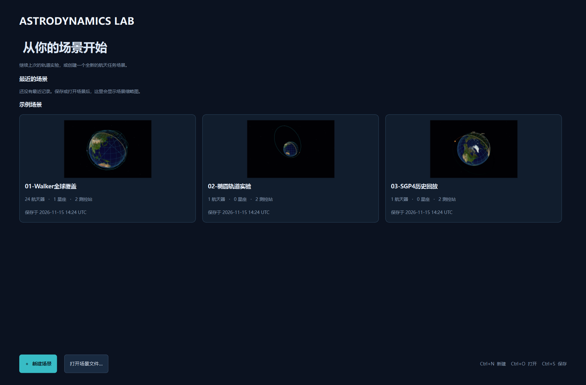

## Running on the configured machine

Double-click `run_demo.bat`, or run the following from the project directory:

```powershell
.\.venv\Scripts\python.exe main.py
```

An isolated Python 3.12 environment and the required dependencies are already installed in this workspace. The system Python installation has not been modified.

The application starts on the welcome page. Click a scene card to continue, or use **New Scene** (`＋ 新建场景`) at the bottom to open an empty scene. Initializing the graphics context when first entering Orbit View may take a few seconds.

## Saving scenes, loading scenes, and the welcome page

The welcome page displays recently saved or opened scenes as cards with actual thumbnails, scene names, spacecraft / constellation / ground-station counts, and save timestamps. It retains up to 24 recent entries in a scrollable list. Files that have been moved or deleted are marked unavailable; use **Open Scene File** (`打开场景文件…`) to locate them again.

On first launch, before any recent entries exist, three loadable examples are available: Walker global coverage, an elliptical-orbit experiment, and an SGP4 historical replay. These files are stored in `examples/`. The SGP4 example uses a historical validation TLE from 2000 and does not represent a current orbit.

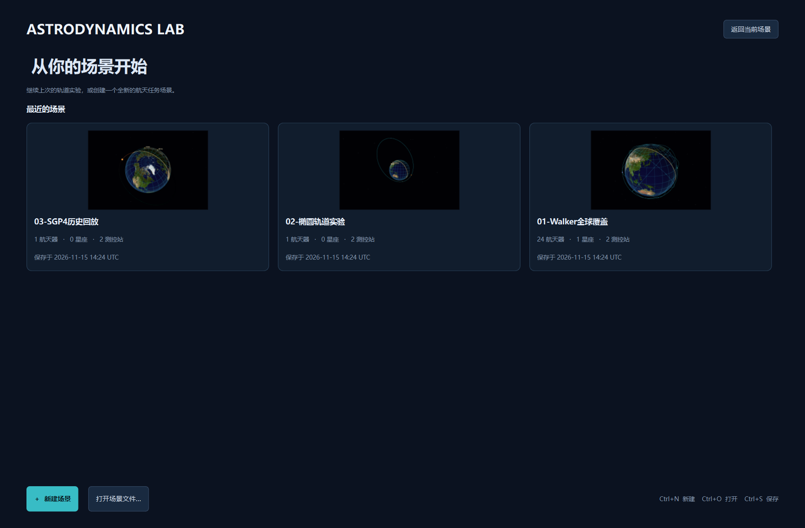

1. **New:** Click **New Scene** (`＋ 新建场景`) or press `Ctrl+N`. Start with an empty scene, then add individual spacecraft, Walker constellations, or ground stations.
2. **Save:** Click **Save** (`保存`) in the upper-right corner of the workspace or press `Ctrl+S`. Choose a file location the first time. **Save As** (`另存为`) or `Ctrl+Shift+S` creates a separate copy.
3. **Load:** Click **Open Scene** (`打开场景`) or press `Ctrl+O` to select an `.astro.json` file, or click a scene card on the welcome page.
4. **Return to the welcome page:** **Welcome** (`欢迎页`) retains the current configuration and pauses playback. Use **Return to Current Scene** (`返回当前场景`) to resume editing.

An asterisk (`*`) in the window title indicates unsaved changes to resources or display settings. Creating a scene, opening another file, or closing the window offers Save, Discard, and Cancel options. Playback advancing the clock and camera movement alone do not trigger this configuration-change prompt; manually saving still records the time and camera position at that moment.

Scene files use versioned UTF-8 JSON and contain:

- Each spacecraft's name, identifier, original two-body orbital elements or TLE, and original epoch; Walker group identifiers and complete generation parameters.
- Ground-station names, longitude, latitude, altitude, and visibility; individual spacecraft-body, orbit, and trail visibility, colors, and line widths.
- Geographic-grid spacing, color, width, and shared display switches; the selected spacecraft, common UTC epoch, simulation time, playback multiplier, active tab, and camera view.
- An embedded PNG thumbnail for the scene card. Loading does not depend on the original TLE file path: copying the `.astro.json` file is sufficient to restore the scene in another installation of this application.

Loading restores the saved simulation time and leaves playback **paused**, allowing the configuration to be checked before playback resumes. Empty scenes and scenes containing only ground stations can also be saved.

File parsing, validation, and engine preparation run in the background. The current scene is replaced only after these steps succeed; invalid or damaged files do not clear the existing configuration. Saving uses a temporary file followed by atomic replacement, preserving the original file if writing fails. The file-size limit is 32 MB; a 10,000-spacecraft save/load round trip has been tested.

The recent-file index is stored at `.astro_lab/recent.json` within the project directory. It manages the welcome-page cards only; the selected `.astro.json` file remains the source of the actual scene configuration.

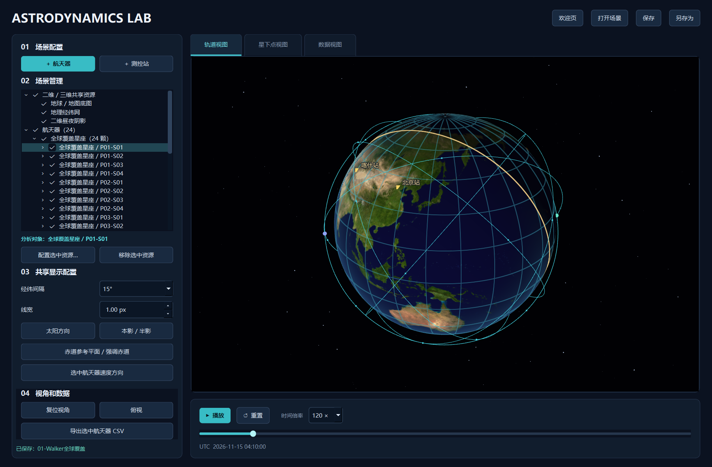

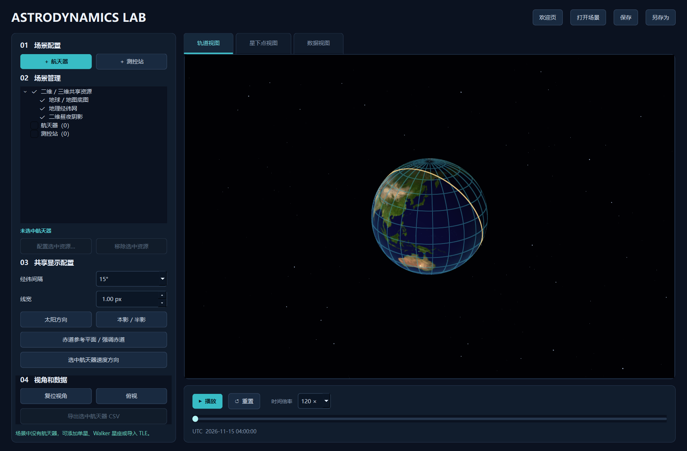

## Features

- A real NASA Blue Marble Earth texture, UTC-driven Earth rotation, a starfield, and solar day/night lighting.
- Two-body and SGP4 dynamics, configured through orbital elements or TLEs, with explicit UTC epochs and reference-frame labels.
- Umbra and penumbra boundaries, a Sun-direction indicator, dimming of eclipsed spacecraft, and visible solar-disc fractions.
- A Chinese Qt control panel with four two-body presets, play/pause, reset, playback multipliers from 1× to 1000×, and a draggable timeline.
- Left-drag camera rotation, mouse-wheel zoom, reset and top views, and grid and shadow-boundary controls. The starfield is always visible.
- Three workspace tabs: **Orbit View / Ground Track View / Data View**, with Orbit View selected by default. The former four summary cards above the views have been removed.
- CSV export of 721 position, velocity, and illumination samples over one period starting at the current simulation time, including model, frame, epoch, and UTC metadata.
- Two-body parameter checks, TLE format and checksum validation, and SGP4 propagation-error handling. Invalid input does not replace the current model.
- Scene-file saving and loading, recent-scene thumbnail cards, three bundled examples, and an empty-scene creation workflow.

## About osgQt

This demo uses **PySide6 / QOpenGLWidget + OpenSceneGraph.py / osgViewer**. The Python implementation in `orbit_demo/scene.py` follows the osgQt embedding pattern: Qt owns the window and OpenGL context, while OSG manages and renders the scene graph.

**The project does not link the historical C++ osgQt library and does not provide a Python package pretending to be `import osgQt`.**

This approach delivers a working version on the configured Windows machine without compiling additional C++ Qt bindings. If a particular C++ osgQt version becomes mandatory, the orbital calculations and controls can be retained while replacing the `OrbitView` embedding layer.

The integration handles Qt's nonzero default framebuffer object, high-DPI viewports, single-threaded rendering, and context cleanup on exit. OSG geometry buffers and shader programs are reused rather than recompiling shaders every frame.

References:

- [OpenSceneGraph.py repository](https://github.com/AlphaPixel/OpenSceneGraph.py)
- [osgQt repository](https://github.com/openscenegraph/osgQt)
- [Qt QOpenGLWidget documentation](https://doc.qt.io/qt-6/qopenglwidget.html)

## Installation on another machine

The documented setup targets Windows x64, Python 3.12, and graphics hardware and drivers supporting OpenGL 3.3. The OSG Python package requires a compatible binary wheel; do not reuse the original Python 3.11 environment on the development machine.

```powershell
py -3.12 -m venv .venv
.\.venv\Scripts\python.exe -m pip install -r requirements.txt
.\.venv\Scripts\python.exe main.py
```

Dependency versions: OpenSceneGraph 0.1.2, PySide6 6.10.1, NumPy 2.x, and sgp4 2.25. The texture is bundled at `assets/earth_day.png`, so the application can run offline after installation.

## Resource management and model configuration

The left sidebar is divided into **01 Scene Configuration / 02 Scene Management / 03 Shared Display Settings / 04 View and Data**.

Section 01 provides **Add Spacecraft** (`＋ 航天器`) and **Add Ground Station** (`＋ 测控站`). Section 02 uses a tree to manage resources shared by the 2D and 3D views. Checkboxes control Earth / the map base layer, the geographic grid, spacecraft bodies / subsatellite points, orbits / ground tracks, and trails in both views.

A spacecraft parent node toggles its three layers together. The top-level spacecraft node controls all spacecraft; mixed visibility is shown with a partially checked state. Left-click selects a node, while its checkbox controls visibility. Right-click a spacecraft, one of its layers, or a spacecraft group and choose **Orbit Color and Line Width** (`轨道颜色与线宽…`) to open a separate preview dialog. Save the orbit/trail style or cancel without applying changes.

Individually added spacecraft and separately created Walker constellations appear at the same tree level. Expand a constellation to access its members. Styling a constellation or any of its members applies the style to the entire constellation; styling an independent spacecraft affects only that spacecraft. The top-level spacecraft node can apply a common style to all spacecraft. Styles affect both views and survive selection changes and resource additions. The geographic-grid node also supports color and width configuration through its context menu. Ground-station context menus provide configuration and removal without irrelevant orbital-style options.

Selecting a spacecraft name or one of its layers changes the analysis target. The data page, selection highlighting, and CSV export follow that selection while preserving the current UTC, playback state, and camera view. Visibility and analysis selection are independent: hidden spacecraft can still be analyzed.

**03 Shared Display Settings** provides geographic-grid spacing options of 5°, 10°, 15°, 30°, 45°, and 90°, along with line width. Toggle buttons control Sun direction, umbra / penumbra, the equatorial reference plane / equator emphasis, and the selected spacecraft's velocity direction. All four buttons are off by default. The reference plane and equator emphasis share one control; Sun direction and shadow boundaries can be toggled independently. The starfield remains visible and has no visibility toggle.

The 2D and 3D views share one settings object and the same geographic-coordinate conventions. The 3D view uses an antialiased shader; the 2D view uses QPainter. Geographic-grid widths are specified in logical pixels, and dense meridians fade near the poles in 3D. Hiding Earth also hides its surface grid. **04 View and Data** contains Reset View, Top View, and Export Selected Spacecraft CSV.

**Add Spacecraft** opens a separate configuration window. Its default operation appends resources; replacing all spacecraft is also available. **Configure Selected Resource** (`配置选中资源…`) edits an individual spacecraft's orbital elements or TLE, a Walker constellation's full parameter set, or ground-station coordinates.

Editing a Walker constellation restores its name, type, spacecraft count, plane count, phasing factor, altitude, inclination, first-plane Ω, first-spacecraft phase, and UTC epoch. Applying changes rebuilds only that constellation while preserving its color scheme. Canceling leaves the scene unchanged. Resource counts and propagation validity near the common epoch are checked before changes are committed; failures preserve the existing scene.

Applying resource-configuration changes resets simulation time to zero and chooses the latest original spacecraft epoch as the scene's starting UTC. Loading a scene file instead restores its saved common epoch and simulation progress. Each spacecraft propagates with the offset from its own original epoch; equal relative times from different TLE epochs are not treated as equal UTC times. Original epochs remain available in tree tooltips and CSV output.

The application supports up to **10,000 spacecraft** and allows the initial or final spacecraft to be removed. An empty scene retains Earth, the starfield, ground stations, and UTC-driven lighting, clears obsolete tracks and charts, and temporarily disables spacecraft CSV export and the orbital-period slider. New resources can still be added. TLE files are limited to 8 MB. Resource and display settings can be saved to `.astro.json` and restored from the welcome page on a later launch.

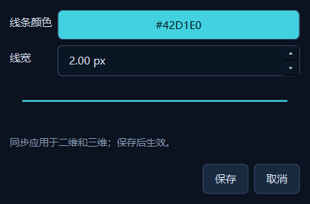

### Ground stations

Click **Add Ground Station** and enter a name, longitude (east positive, ±180°), latitude (north positive, ±90°), and altitude (0–20 km). Stations appear as gold squares and names on the 2D map, and as gold markers and names on the 3D globe, rotating with Earth. In 3D, names follow the camera projection and are occluded on the far side of Earth. Marker and label visibility follow the same station-node setting.

Station nodes support individual and group visibility, editing, and removal. Positions use the same spherical-Earth convention as the globe. The 3D markers are slightly raised above the surface to avoid depth conflicts. This version does not calculate link budgets, coverage footprints, or station-access intervals.

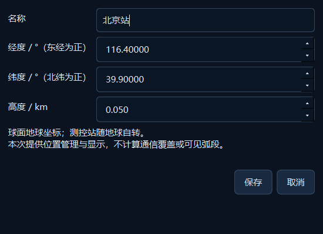

### Two-body model

Edit the six orbital elements and initial UTC, or select presets such as low Earth orbit, geosynchronous orbit, and highly eccentric orbit. The default epoch is fixed at **2026-11-15 04:00:00 UTC** for reproducible experiments.

### SGP4 model

Paste both complete TLE lines, optionally preceded by a satellite-name line. Each TLE line must contain 69 ASCII characters, preserving spaces and the final checksum digit. The editor supports horizontal scrolling to display complete lines.

**Read TLE File** (`读取 TLE 文件…`) imports UTF-8 or UTF-8-with-BOM `.tle` and `.txt` files containing multiple spacecraft. Named three-line records and unnamed two-line records can be mixed. The entire file must validate before loading; invalid records are not silently skipped. Duplicate satellite catalog numbers within one file produce an error. Single-spacecraft imports start at the TLE epoch; multi-spacecraft imports use a common UTC epoch.

The bundled VANGUARD 1 record is a **historical validation example dated 2000-06-27, not a live orbit**. The application does not automatically update TLEs over the network. For meaningful predictions, use TLEs close to the intended simulation date.

SGP4 uses `sgp4.api.Satrec` / `SatrecArray` with WGS72 constants, automatically choosing the near-Earth or deep-space branch. The six-element editor is not used to initialize SGP4, avoiding confusion between instantaneous two-body elements and TLE mean elements.

SGP4 outputs **TEME**, not J2000 or ECEF. The displayed orbit is sampled over one mean period starting at the current time. The selected spacecraft's detailed 3D trajectory refreshes whenever simulation time crosses a 60-second boundary; other trajectories follow the background-sampling schedule. Paths are not forced to close, and propagation time is not reduced modulo the period.

Model-level eccentricity, inclination, and period are based on TLE mean parameters; corresponding apsidal estimates are mean-element estimates rather than instantaneous extrema. If the selected propagator reports decay or an invalid state, playback pauses and an error is displayed. Other visible spacecraft with propagation errors have their layers hidden and are reported to the user.

### Walker constellations

The **Walker Constellation** tab configures the constellation name, Delta / Star type, total spacecraft count T, plane count P, phasing factor F, altitude, inclination, first-plane Ω, and first-spacecraft phase. It uses circular two-body orbits, requires T to be divisible by P, and enforces `0 ≤ F < P`.

Using zero-based plane index p and within-plane spacecraft index s:

```text
Spacecraft per plane: S = T / P
Ω(p) = Ω₀ + p × 360° / P  (Delta), or Ω₀ + p × 180° / P (Star)
ν(p,s) = ν₀ + s × 360° / S + p × F × 360° / T
```

The epoch comes from the UTC field at the top of the configuration window. All orbits and trails within one constellation share a color; the selected spacecraft body remains orange. Every creation operation receives a distinct constellation identifier, so identically named constellations are not merged. Group visibility, styling, full parameter editing, and removal are supported, together with actual multi-spacecraft propagation, 3D rendering, 2D tracks, and per-spacecraft data analysis.

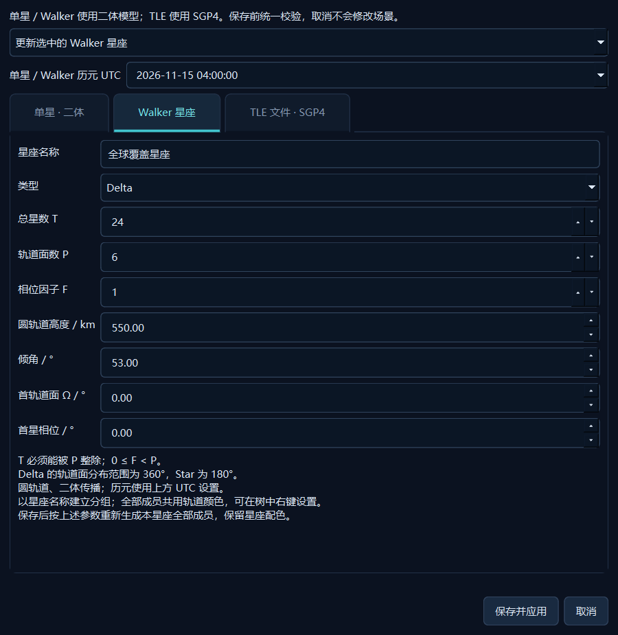

Convention reference: [STK Walker](https://help.agi.com/stk/12.7.1/Content/stk/tools-12.htm).

## Views and chart integration

All three workspace tabs share one simulation clock. Switching tabs does not reset the model, playback progress, or 3D camera.

- **Orbit View:** An OSG scene containing Earth, spacecraft, orbits, lighting, and shadow geometry. Geographic-grid spacing defaults to 15°, with equator emphasis off. The grid shares the Earth-fixed UV coordinates of the texture and rotates with it; styles and visibility are controlled from the sidebar. The former footer information, duplicate in-page title, upper-right status text, timeline-side progress description, and application-bottom technical text have been removed to increase the display area. The timeline retains its live UTC label.
- **Ground Track View:** A local NASA texture map showing the current subsatellite point, the next full period of ground track, and a trail covering the preceding 10% of a period. Tracks follow resource or constellation colors; an independently selected spacecraft without a custom style uses a cyan orbit and orange trail. The equirectangular map splits paths at ±180° longitude. Subsatellite latitude is geocentric; longitude is the inertial longitude minus GMST at the current UTC, matching the approximate Earth-rotation convention in 3D. Polar motion, UT1 corrections, and geodetic-latitude conversion are not included. Current points update continuously; background track sampling pauses while the view is hidden and refreshes when it becomes visible. Day/night shading uses the same UTC-derived Sun direction, with a narrow twilight transition and a pale-gold terminator line in both views. Night-overlay opacity is capped at approximately 58% to keep surface features readable. Tracks, grids, spacecraft, and stations are drawn above the shading. The **2D Day/Night Shading** tree option controls this overlay independently. The former top explanatory line has been removed.
- **Data View:** Eight time histories show orbital altitude, inertial speed magnitude |v|, semimajor axis a, eccentricity e, inclination i, right ascension of the ascending node Ω, argument of periapsis ω, and true anomaly ν. Scroll vertically to see all plots. Orange cursors follow the current simulation time; the numeric value in each plot is computed for that time rather than interpolated from the plotted samples.

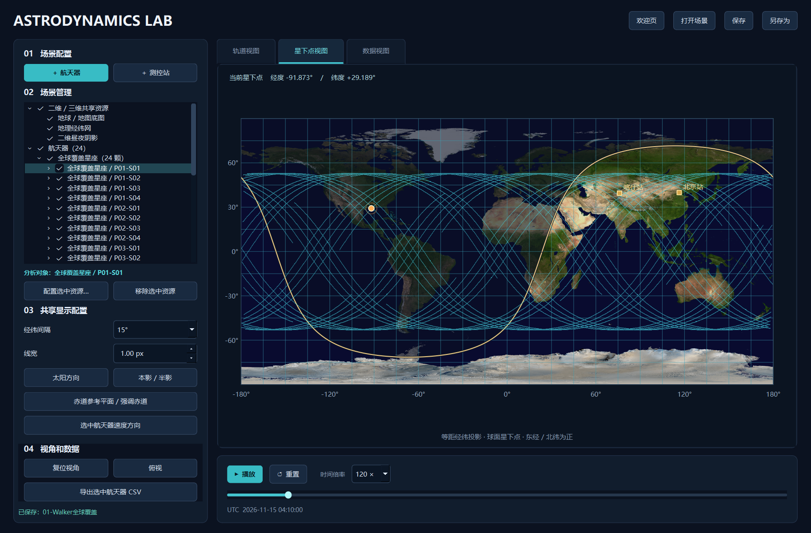

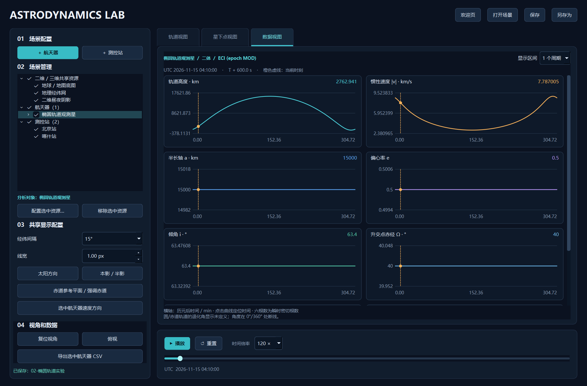

<details>
<summary>More orbit-example screenshots</summary>

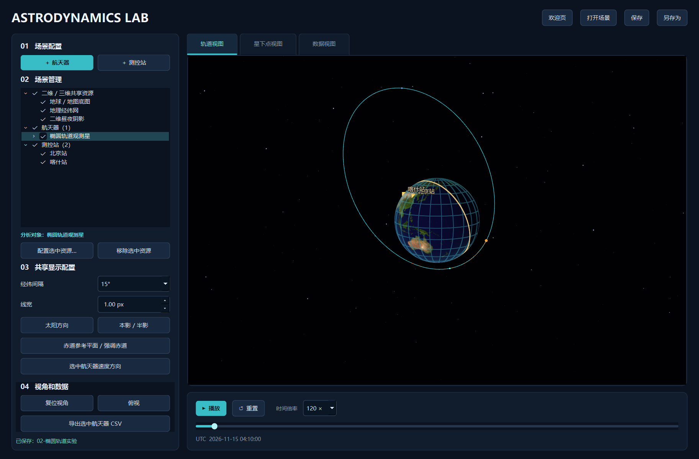

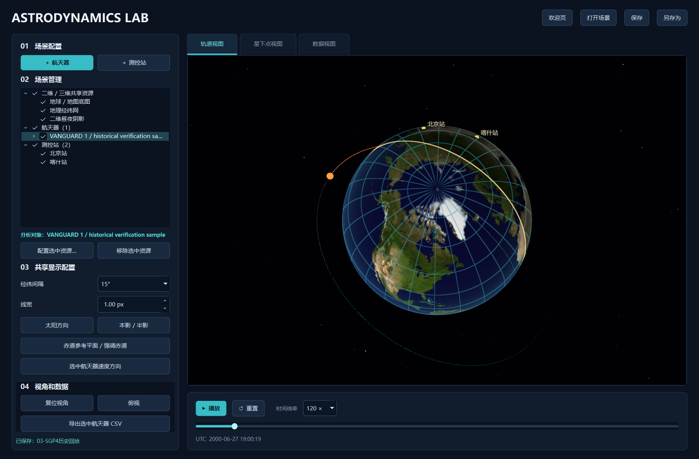

</details>

Altitude is defined as `|r| − 6378.137 km`. Speed is `sqrt(vx²+vy²+vz²)` in the model's native inertial frame, without subtracting Earth's rotation. The two-body model uses its epoch ECI frame; SGP4 uses TEME, explicitly labeled in the data-page heading. TEME components are not presented as J2000 components.

Orbital elements are reconstructed from each sampled position and velocity. SGP4 analysis uses its WGS72 gravitational parameter and shows **instantaneous osculating elements**, rather than repeating TLE mean elements as constant curves. For unperturbed two-body motion, a, e, i, Ω, and ω are theoretically constant while ν changes with time.

For circular orbits (`e < 1e-8`), ω and ν are not uniquely defined; for equatorial orbits (`sin(i) < 1e-8`), Ω and ω are not uniquely defined. These angles are labeled undefined and left blank. Curves break at 0°/360° discontinuities and at propagation failures, avoiding misleading connecting lines. See the [NAIF osculating-elements documentation](https://naif.jpl.nasa.gov/pub/naif/toolkit_docs/C/cspice/oscelt_c.html) for background on state conversion and degenerate orbits.

The horizontal axis shows minutes since the scene epoch. Select a one-period or three-period display window. Each period uses 480 sampling intervals; playback crossing the end of a window advances to the next window. Normal playback updates only the cursor. Samples are recomputed when the model, parameters, display span, or time window changes.

Sampling pauses while the data page is hidden and refreshes when it is shown. Clicking or dragging a chart seeks the shared simulation time, updating both spatial views and the timeline, including while paused. The bottom slider continues to seek within the initial period; during multi-period playback it displays the current orbital phase.

Custom Qt charts can replace the built-in plots through `DataView` in `orbit_demo/data_view.py`:

```python
window.data_view.set_chart_widget(chart_widget)  # The page takes ownership of the QWidget.
snapshot = window.data_view.latest_state        # Initial chart state.
window.data_view.state_updated.connect(on_state_updated)
# window.data_view.set_chart_widget(None)       # Restore the built-in charts.
```

`SimulationSnapshot` is immutable and contains the selected spacecraft name, model name, reference frame, common epoch UTC, current UTC, simulation seconds, position in km, and velocity in km/s. All pages use the same propagated state. `latest_state` and `state_updated` continue to update while the data page is hidden. External integrations should throttle expensive sampling and plotting to avoid blocking the Qt main thread. An empty scene clears the snapshot and emits `None`; integrations should handle that state.

## Models and units

The two-body model represents unperturbed Earth–test-spacecraft motion. Earth is at the inertial origin, spacecraft mass is neglected, and the gravitational parameter is μ = 398600.4418 km³/s². The rendered Earth and shadow sphere use radius R = 6378.137 km.

The two-body model supports closed elliptical orbits without J₂, drag, or third-body forces. SGP4 uses its standard perturbation model. The two-body reference frame is defined by the mean equator and equinox at the initial epoch; small frame changes over the short demonstration interval are neglected. The GEO preset still orbits Earth in the inertial frame, while the Earth texture rotates according to GMST and the ground-track view shows Earth-fixed longitude and latitude.

The six input elements are semimajor axis a, eccentricity e, inclination i, right ascension of the ascending node Ω, argument of periapsis ω, and initial true anomaly ν₀. The solver advances mean anomaly with `M(t) = M₀ + sqrt(μ/a³) t`, solves `M = E − e sin(E)` for eccentric anomaly, and rotates orbital-plane position and velocity into the geocentric inertial frame. A bracket-constrained Newton iteration supports high eccentricities; spacecraft do not move around ellipses at constant angular speed.

Computational units are km, s, and degrees; rendering uses Earth radii. Earth and orbits share a consistent distance scale, while spacecraft and apsis markers are enlarged symbols. Altitude is radial height above a sphere, not ellipsoidal geodetic height. The velocity indicator shows direction only. For circular orbits, apsis markers are reference points placed according to the specified periapsis-direction convention.

Trails cover the preceding 10% of an orbital period, so a trail is present even after resetting to the initial time. The default selected-spacecraft trail is orange unless a resource or constellation style overrides it. The timeline represents one period from the input initial state: dragging seeks within that period, while playback can continue across multiple periods.

## Earth texture, Sun, and shadows

The Earth texture comes from [NASA SVS Blue Marble](https://svs.gsfc.nasa.gov/2915/), a composite of actual remote-sensing observations rather than live imagery. Original-image details, attribution, and SHA-256 hashes are recorded in [assets/SOURCES.md](assets/SOURCES.md). The starfield consists of 4,200 points generated with a fixed random seed; it is decorative and does not represent a measured star catalog.

The Sun position follows the [USNO approximate solar-coordinate formula](https://aa.usno.navy.mil/faq/sun_approx). The current UTC drives Earth lighting, the gold Sun-direction arrow, shadow wireframes, and the visible solar-disc fraction at the selected spacecraft. The arrow indicates direction only; it is not a Sun placed at its true scaled distance.

Umbra and penumbra classification compares the apparent Earth and solar discs as seen from a spacecraft. The obscured solar fraction uses an angular-disc overlap approximation. The Sun has a finite radius and is not treated as a point source. Purple wireframes mark the umbra boundary; blue-gray wireframes mark the penumbra boundary. The displayed wireframes extend only six Earth radii away from the Sun. The actual umbra cone is much longer and appears nearly cylindrical at this scale. Hiding the wireframes does not disable illumination calculations.

Spacecraft markers retain some brightness in umbra for visibility, and the night hemisphere retains a small illustrative ambient brightness. The selected spacecraft uses the finite solar-disc calculation. Large batches of other spacecraft markers use a cheaper cylindrical-shadow approximation for dimming; this approximation is not used for CSV illumination output or selected-spacecraft illumination analysis.

The approximate solar model has accuracy on the order of an arcminute. This demo neglects small nutation differences between the solar coordinate frame and TEME, approximates UT1 with UTC for GMST, and neglects polar motion, detailed solar light-time effects, atmospheric refraction, and Earth oblateness. Solar and shadow effects are for visualization; they do not add solar-radiation pressure to the dynamics and are not intended for precision eclipse prediction.

## Large-scale rendering and threading

- The Qt main thread handles interaction, the OSG scene graph / OpenGL context, and submission of completed data. Worker threads do not manipulate QWidgets or OpenGL objects.
- The `constellation-dynamics` thread computes all spacecraft states using NumPy-vectorized Kepler propagation and native `SatrecArray` calls.
- The `trajectory-geometry` thread samples orbits and trails and generates offscreen 2D QImages. Chart sampling uses a separate `telemetry-analysis` thread.
- Configuration import and scene validation run in the background. Scene-file I/O and loading preparation use the `scene-files` worker. Propagation workers have independent SGP4 instances to avoid sharing mutable deep-space propagator state.
- For scenes containing more than 128 SGP4 spacecraft, dense trajectory sampling runs in one separate process, isolating the native extension's Python GIL usage. The process exchanges numerical arrays and raster bytes only and does not access windows or OSG. Old computation processes are retired when switching scenes. This arrangement follows the behavior of the [SGP4 2.25 native batch implementation](https://github.com/brandon-rhodes/python-sgp4/blob/2.25/extension/wrapper.cpp).
- Each task channel retains at most one running task, one pending task, and one completed result. New tasks replace older tasks that have not started. Scene, visibility, selection, seek, and tab revisions prevent late results from overwriting current state. Threads are stopped and joined on exit.

The 3D renderer batches unselected spacecraft bodies, orbits, and trails, plus a ground-station batch, instead of creating a sphere, transform node, and shader for every spacecraft. All enabled spacecraft are propagated and displayed. Identical two-body ellipses with matching colors share an orbit curve, while bodies and trails remain separate. The resource tree uses a virtual model and creates layer nodes on expansion, avoiding tens of thousands of eagerly created Qt items or cascades of per-item signals.

The interface timer targets a 16 ms interval; actual frame rate depends on hardware and load. Background trajectories are submitted approximately once per second for up to 1,000 spacecraft and once every three seconds for larger scenes. If the previous task is unfinished, submission waits rather than accumulating work. Small-scene curves use 129 points, large-scene curves use 65 points, and batch trails use 13 points. The selected spacecraft's 3D orbit retains 721 points. All 2D tracks are cached in a 1600×800 image, with current point positions updated independently.

Consequently, cached trajectories can lag current spacecraft positions slightly, especially at high playback multipliers or after a time jump. Reducing rendering sample counts does not reduce the accuracy of propagated spacecraft states.

## Validation

```powershell
.\.venv\Scripts\python.exe -m pip install -r requirements-dev.txt
.\.venv\Scripts\python.exe -m pytest -q
.\.venv\Scripts\python.exe main.py --smoke-test
.\.venv\Scripts\python.exe main.py --benchmark
.\.venv\Scripts\python.exe main.py --gallery
```

Numerical tests cover two-body conserved quantities, Vallado SGP4 reference state vectors at 0, 360, and 1440 minutes, epoch handling, nonperiodic propagation, the deep-space branch, invalid TLEs, propagation failures, solar solstice directions, sidereal time, and shadow-boundary continuity. They also cover subsatellite coordinates, date-line splitting, approximately stationary GEO ground tracks, prograde and retrograde element reconstruction, degenerate angles, SGP4 osculating-element variations, Walker Delta / Star geometry and phasing, invalid configurations, multi-spacecraft TLEs, common-UTC offsets, and repeated alignment.

Window integration tests require a desktop and working graphics hardware. They open windows and exit automatically, exercising actual OSG rendering, 24-spacecraft scenes, tree visibility controls, selection preserving UTC and camera state, shared-grid rendering, TLE loading, configuration validation and cancellation, rollback on resource-count errors, chart seeking, playback/timeline synchronization, sampling caches, mixed-model additions and removals, and CSV export. Further coverage includes batch/scalar agreement for high-eccentricity, retrograde, mixed-epoch, and mixed-model cases; 10,000-spacecraft states; night-overlay opacity and solar direction; Earth-fixed station rotation; asynchronous charts; and resource operations.

Window screenshots such as `lab_3d.png`, `lab_2d.png`, `lab_data.png`, `lab_configuration.png`, and `lab_station.png`, together with CSV output, are stored in `artifacts/`.

`--gallery` uses real Qt / OSG windows to generate the documentation screenshots in `docs/images/` and regenerate the three demonstration scenes in `examples/`. If you have edited those examples, save your own copies first: gallery generation overwrites the demonstration files. Tests and gallery generation use separate recent-file indexes under `artifacts/`, leaving normal welcome-page history untouched.

`--benchmark` loads 10,000 Walker spacecraft and 10,000 synthetic SGP4 test spacecraft in actual windows, with bodies, orbits, and trails enabled. It measures the 3D, 2D, and chart tabs while rotating the camera, scrolling the resource tree, and seeking in time. Frame rates, propagation timings, and delays of a 10 ms GUI heartbeat are written to `artifacts/benchmark_10000.json`, along with screenshots of each scenario. The SGP4 catalog is synthesized from a historical Vallado validation orbit and is not a live satellite catalog. Results apply only to the recorded hardware, window size, and test cases; they do not guarantee a fixed frame rate on arbitrary graphics cards or catalogs.

Recorded local validation on **2026-11-15** used an RTX 4060, a 1460×960 logical-pixel window, and 125% DPI scaling. Each of the three views was measured for approximately six seconds per model. The two-body 3D case reached **65.4 FPS** and the SGP4 3D case **65.9 FPS**. Across the six cases, GUI-heartbeat P95 intervals were 19–38 ms, with a maximum interval of 226 ms from an occasional stall in the SGP4 data view. These are short interaction stress tests, not long-duration stability certification or certification for arbitrary TLE catalogs.

The current automated regression suite contains **102 tests**, in addition to real Qt / OSG window integration checks. Scene-file tests cover mixed models, original epochs, Walker groups, complete styles and visibility, 10,000-spacecraft round trips, rejection of damaged files, and preservation of the original file after failed atomic writes. Window tests cover the initial welcome page, opening recent cards, restoration in a new window, canceling unsaved-change prompts, and saving/loading empty scenes, alongside the existing editing and rendering regressions.

## Project structure

- `main.py`: Application entry point.
- `orbit_demo/mechanics.py`: UI-independent two-body calculations.
- `orbit_demo/propagators.py`: Two-body adapter, TLE validation, and SGP4 interface.
- `orbit_demo/environment.py`: Solar position, Earth rotation, eclipse fractions, and shadow boundaries.
- `orbit_demo/groundtrack.py`: Spherical subsatellite coordinates, date-line splitting, and the map view.
- `orbit_demo/data_view.py`: Data page, time-window cache, chart-host interface, and shared state snapshots.
- `orbit_demo/charts.py`: Qt time-series plots, cursors, and mouse-based seeking.
- `orbit_demo/telemetry.py`: Osculating-element reconstruction and telemetry sampling.
- `orbit_demo/scene.py`: Qt/OSG embedding and the 3D scene.
- `orbit_demo/resources.py`: Multi-spacecraft resources, Walker generation, TLE catalogs, and common-epoch alignment.
- `orbit_demo/resource_panel.py`: Resource tree and shared 2D/3D style controls.
- `orbit_demo/line_style.py`: Context-menu color, line-width, and preview dialog.
- `orbit_demo/resource_tree.py`: Virtual resource-tree model supporting 10,000 spacecraft.
- `orbit_demo/batch.py`: Batch dynamics, trajectory sampling, and combined vertex data.
- `orbit_demo/geometry_service.py`: Process isolation for large SGP4 trajectory workloads.
- `orbit_demo/workers.py`: Bounded background tasks and result mailboxes.
- `orbit_demo/map_raster.py`: Batch rasterization of 2D tracks and point markers.
- `orbit_demo/stations.py`: Ground-station configuration dialog.
- `orbit_demo/station_labels.py`: 3D station-name projection and Earth occlusion.
- `orbit_demo/configuration.py`: Separate single-spacecraft, Walker, and TLE configuration.
- `orbit_demo/app.py`: Main window, resource synchronization, timing, and export.
- `orbit_demo/scene_store.py`: Versioned scene format, validation, atomic writes, and recent-file records.
- `orbit_demo/scene_actions.py`: Background save/load workflows, unsaved-change prompts, and restoration.
- `orbit_demo/welcome.py`: Welcome page, scene cards, and new-scene entry point.
- `orbit_demo/gallery.py`: Reproducible example-scene and documentation-screenshot generation.
- `orbit_demo/smoke.py`: Real Qt / OSG window integration checks.
- `tests/test_mechanics.py`: Orbital-physics tests.
- `tests/test_propagators.py`: SGP4 reference vectors and solar/shadow tests.
- `assets/earth_day.png`: Bundled NASA Earth texture.
- `run_demo.bat`: Windows double-click launcher.
- `examples/`: `.astro.json` examples available directly from the welcome page.
- `docs/images/`: Actual application screenshots used in the documentation.

`.venv/`, `.python/`, `.tools/`, `.uv-cache/`, and `.reference/` contain local environments or development references and are excluded by `.gitignore`.
